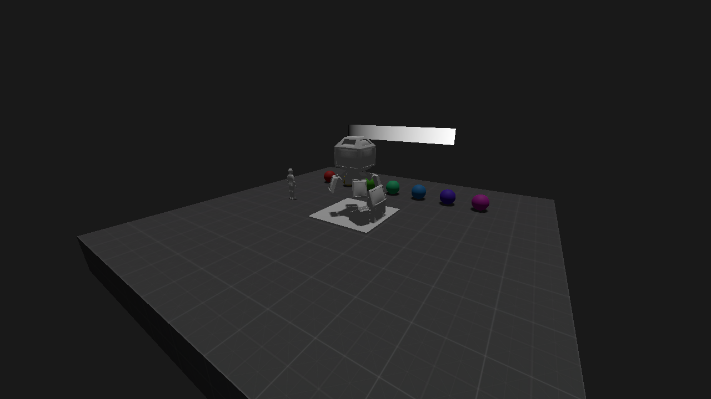
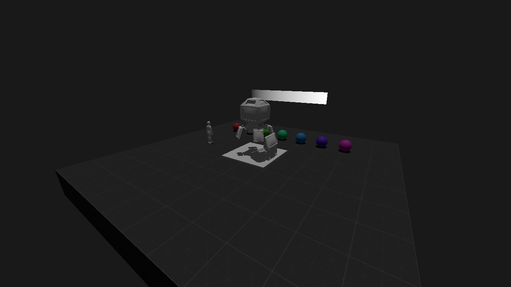
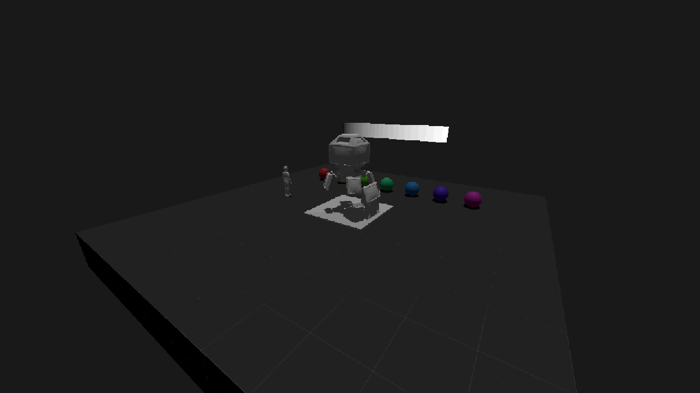

# SEN-5 — pós-processamento e revisão visual

## Teste rápido

Abra `res://debug/visual/visual_debug.tscn` e pressione **F6**. O DevAssistance oferece menus móveis e retráteis: paleta para Visual e frasco para Experimento. No Scene Browser, busque **Character** para abrir LocalPlayer. Fixe **Caminhada** para acompanhar o personagem ou **Experimento → Órbita** para ver o aviso ao pressionar **F4**; ScreenSpace alterna as observações fixadas. Use **Ctrl+Alt+D** para abrir/ocultar as ferramentas e role os menus para acessar os controles. [Guia de uso, presets e integração](../../addons/dev_assistance/README.md).

| Controle | Ação |
| --- | --- |
| F1 | Liga/desliga todo o filtro |
| F2 | Alterna sombras anteriores (100 m) / atuais (30 m) |
| F3 | Alterna o material anterior / corrigido do chão |
| F4 | Liga/desliga a órbita para examinar estabilidade em movimento |
| Home | Volta à câmera e ao ângulo inicial; sai do personagem |
| Câmera do personagem | Usa o controle existente: mouse, WASD/setas, Shift; Esc libera o mouse |
| Botões de resolução | 1280×720, 1920×1080 e 800×600; também é possível redimensionar livremente |
| Medir e capturar A/B | Oculta o painel, mede quatro configurações nas três resoluções e salva CSV/PNG em `user://sen5/` |

Na árvore **Remote**, `Room/WorldPostProcess` expõe todos os controles. `Room/DirectionalLight3D` permite ajustar alcance, splits, bias e blur pelas propriedades nativas da Godot. O material do chão pode ser ajustado em `Room/FloorBlock/MeshInstance3D > Material Override > Shader Parameters`. Os controles do DevAssistance acompanham alterações do Inspector remoto; presets persistem somente os parâmetros registrados em `user://devassistance/presets.cfg`.

Em `res://debug/multiplayer/multiplayer_debug.tscn`, use **F6 → Testar 2 janelas**. **F8** alterna o filtro apenas na janela ativa. Ajustes individuais: `MultiplayerDebug/WorldPostProcess` no Inspector remoto. Conecte/desconecte para alternar entre visão geral e câmera local. A interface permanece acima do filtro e o overlay ignora o mouse.

## Método e integração

Uma instância de `effects/world_post_process.tscn` pertence à sala/viewport, sem autoload, RPC ou instâncias nos personagens. Trocar a câmera não recria o efeito. Cada instância usa seu próprio ShaderMaterial. **CanvasLayer 1** contém o filtro; **HUD e menus devem usar CanvasLayer 10 ou superior**. A interface do multiplayer e do teste visual segue essa convenção. Não coloque interface que precise ficar nítida em camadas abaixo do filtro.

Ordem da passagem: amostragem pixelizada → saturação por luminância Rec.709 → contraste em torno de 0,5 → clamp [0,1] → quantização RGB com arredondamento ao nível mais próximo. A quantização inclui preto e branco; 32 níveis significam 32 valores por canal. Opera sobre a imagem de tela já produzida pelo renderer, após o Environment. Não é uma LUT, uma paleta artística ou quantização perceptual.

Padrão: altura virtual **540**, **32 níveis**, contraste **1**, saturação **1**. A largura virtual acompanha o aspecto (960 em 16:9). O tamanho de amostragem é igual nos dois eixos; a imagem não é esticada ao redimensionar. Abaixo da resolução virtual, o passo mínimo é um pixel nativo. Passos fracionários podem produzir blocos com larguras físicas alternadas. Contraste/saturação 1 são neutros; saturação 0 produz cinza. Cada operação tem um interruptor próprio. Desligar o filtro oculta o ColorRect e evita a passagem/cópia solicitada por ele. Pixelizar a amostragem **não reduz a resolução nem o custo do render 3D**.

O Environment mantém iluminação e tonemapping existentes, com `adjustment_enabled = false`. Valores de ajustes e SSAO que estavam salvos, mas desabilitados, foram removidos para evitar ambiguidade. Contraste e saturação são controlados apenas pelo filtro.

## Materiais e sombras

O chão somava três texturas de projeção com peso 1. A correção usa a normal em espaço de mundo e pesos normalizados, evitando contribuição de faces ortogonais. O escurecimento observado decorre dessa correção, sem compensação de contraste ou exposição. A rugosidade 0 do piso não metálico foi substituída por **0,85**, como ponto inicial de piso fosco de protótipo. A aparência final é ajustável no material; isso não pretende definir o acabamento artístico definitivo.

O alcance direcional da sala passou de **100 m para 30 m**, compatível com o piso atual de 10×10 m. A comparação sem filtro mostrou uma borda de sombra menos difusa/serrilhada no recorte da base da Máquina. Ainda há serrilhado e mudança dos texels durante a órbita: não é uma solução universal de estabilidade temporal. Não foi isolado um defeito de acne ou sombra descolada que justificasse mudar bias. Atlas, qualidade global, filtragem e splits permaneceram nos valores existentes. O debug multiplayer mantém sua iluminação própria. Ao aumentar a sala, reavalie o alcance para não perder sombras distantes.

Comparações na mesma câmera, sem filtro, exceto a última:

| Anterior | Materiais corrigidos |
| --- | --- |
|  |  |

| Materiais + sombras | Resultado com filtro |
| --- | --- |
|  |  |

Capturas no último ângulo da mesma órbita, com o filtro desligado: [anterior](sen5_evidence/1280x720_true_before.png), [corrigido](sen5_evidence/1280x720_true_shadows.png). Confira a sequência em movimento usando F4/F2. Outros aspectos: [1920×1080](sen5_evidence/1920x1080_false_filtered.png), [1100×800](sen5_evidence/1100x800_false_filtered.png).

## Validação e desempenho

Coleta em 03/11/2026: **Godot 4.7.1 stable**, Forward+, D3D12, **AMD Radeon(TM) Graphics**, driver Windows 31.0.21921.1000. Desktop de desenvolvimento, com editor e teste IK preexistentes abertos; sem GPU-alvo ou orçamento de FPS acordado. É uma medição local, sem isolamento de carga/temperatura e sem garantia para outros computadores.

Cada caso aquece 120 frames e mede 240. VSync e limite de FPS são desligados e restaurados ao terminar; câmera, tamanho da janela e estados de comparação também são restaurados. A órbita de medição usa os mesmos 240 ângulos em cada caso. PNGs são gravados depois da janela medida. Os casos `before`, `materials`, `shadows`, `filtered` adicionam respectivamente: referência original; correção de material; alcance 30 m; filtro. O shader original é preservado apenas em `debug/visual/reference/` para comparação, sem uso pela cena principal.

Dados completos, incluindo **ms/frame, FPS e GPU por etapa**, em [measurements.csv](sen5_evidence/measurements.csv). O tempo de GPU reportado pela Godot não substitui o tempo total do frame. A queda de tempo total em alguns casos não demonstra otimização; há variação de carga/aquecimento.

| Resolução / câmera | GPU anterior → materiais → sombras → filtro (ms) | Frame anterior → final (ms) | FPS anterior → final |
| --- | --- | --- | --- |
| 1280×720 / parada | 1,183 → 1,194 → 1,287 → 1,789 | 4,809 → 4,019 | 208,0 → 248,8 |
| 1280×720 / órbita | 1,235 → 1,268 → 1,338 → 1,708 | 3,497 → 3,774 | 285,9 → 265,0 |
| 1920×1080 / parada | 2,432 → 2,445 → 2,286 → 3,025 | 4,976 → 5,297 | 201,0 → 188,8 |
| 1920×1080 / órbita | 2,312 → 2,318 → 2,436 → 3,241 | 4,936 → 5,687 | 202,6 → 175,8 |
| 1100×800 / parada | 1,264 → 1,297 → 1,395 → 1,720 | 3,454 → 3,764 | 289,5 → 265,7 |
| 1100×800 / órbita | 1,310 → 1,346 → 1,438 → 1,779 | 3,555 → 3,968 | 281,3 → 252,0 |

O custo adicional observado do filtro, comparado a `shadows`, foi **0,33–0,81 ms de GPU**. Há regressão de tempo de frame/FPS em vários casos, sobretudo 1080p em órbita. Não se afirma ganho de desempenho. Para comparar outro preset, ajuste os controles e repita a coleta; o CSV registra os parâmetros numéricos do filtro e sobrescreve a coleta anterior em `user://sen5/`.

Verificações executadas com renderer real:

- `Godot --path . --script res://debug/visual/verify_post_process.gd`: 15 verificações passaram, incluindo neutralidade, cinza, quantização, bypass, atualização em runtime, HUD nítido, materiais independentes entre viewports, blocos quadrados nas três resoluções e troca de câmera sem duplicação.
- Duas instâncias ENet conectadas: dois personagens, câmera local correta, um overlay em cada viewport; saturação zero no host preservou saturação 1 no cliente. Troca de câmera, saída do cliente, retorno à visão geral e preservação do filtro passaram.
- Importação e execução sem erros de shader/script. Teste visual permite repetir as comparações e o controle do personagem sem avançar no jogo.

Referências: [pós-processamento customizado](https://docs.godotengine.org/en/stable/tutorials/shaders/custom_postprocessing.html), [luzes e sombras](https://docs.godotengine.org/en/stable/tutorials/3d/lights_and_shadows.html).
